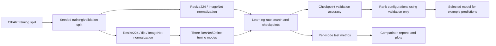

# ResNet-50 transfer learning on CIFAR

An experimental PyTorch notebook comparing three ResNet-50 fine-tuning strategies on CIFAR-10 or CIFAR-100. It implements a training/validation split, learning-rate search, validation-loss checkpointing, and held-out test evaluation. No accuracy or training-time claim is independently reproduced here.

## Experiment flow



| Mode | Trainable parameters |
|---|---|
| `fully_frozen` | Final classifier only; backbone BatchNorm statistics stay fixed |
| `partially_frozen` | `layer3`, `layer4` and classifier; early BatchNorm statistics stay fixed |
| `fully_trainable` | Entire network |

The notebook still reports test metrics for all predeclared modes for comparison. Model selection now uses **validation accuracy**, not test accuracy. Do not tune subsequent experiments against the displayed test scores.

There are no committed evaluation images or trained checkpoints to substantiate a results gallery. The diagram shows the source pipeline; no training curves or example accuracy values have been invented.

## Open the notebook

Use an isolated Python environment with a compatible PyTorch/torchvision pair. The manifest lists the notebook's imports but is not a locked or fully installation-tested environment.

```powershell
python -m pip install -r requirements.txt
python -m pip install jupyterlab
python -m jupyterlab resnet50_transfer_learning_cifar_colab.ipynb
```

Alternatively open the notebook in VS Code or Google Colab. An `.ipynb` file is notebook JSON; do not execute it with `python notebook.ipynb`.

Running the dataset/model cells downloads CIFAR and pretrained ImageNet weights. Full training was not performed during this audit. Inspect disk, memory and compute requirements before running all cells.

## Configuration

The configuration cell exposes `DATASET_NAME`, `BATCH_SIZE`, `IMAGE_SIZE`, `VAL_SPLIT`, `RANDOM_SEED`, learning-rate candidates and epoch limits.

- Images are resized to 224 x 224 and normalized with ImageNet mean/std.
- Training/validation use disjoint indices from the CIFAR training split; validation/test use non-augmented transforms.
- Default seed is 42. Seeding does not establish bitwise determinism across all GPU/library versions.
- `FAST_RUN` defaults to true without CUDA. It limits training to 200 examples, validation to 50 and test to 50, and uses one epoch. It still downloads the full datasets and pretrained weights.
- `NUM_WORKERS` is 0 on Windows and 2 elsewhere.
- On a 6 GB GPU, the default batch 64 may exceed available memory for fully trainable mode. Reduce it before trying a run; that configuration has not been hardware-benchmarked here.

Checkpoints are written under `saved_models/`. Use only trusted checkpoint files. The notebook reloads the best validation-loss weights before measuring validation/test accuracy.

## Verified offline checks

The selection regressions need only pandas and the standard library:

```powershell
python -m pip install pandas
python -m unittest discover -s tests -v
```

On 2026-11-07, two regressions failed on the original notebook and all three checks passed after repair. They execute the actual comparison cell with explicitly synthetic fixture metrics, exercise `run_experiment` with fake training/model boundaries, and parse Python cells for syntax. They do not import PyTorch, download data, train models or establish model accuracy.

## Limits and next measurements

- Record exact dependency/GPU versions, dataset checksums, seed and selected configuration for each real experiment.
- Compare repeated seeds and include uncertainty rather than presenting one run as definitive.
- Freeze the validation-selected configuration before a final test assessment.
- The split is randomized rather than explicitly stratified; dataset provenance and licensing must be reviewed before redistributing images.
- CPU/GPU training time, best mode, final accuracy, calibration and robustness remain unverified.

Files: the notebook contains the experiment; `tests/test_model_selection.py` contains offline regressions; `requirements.txt` lists imports. No repository-wide license is declared.
